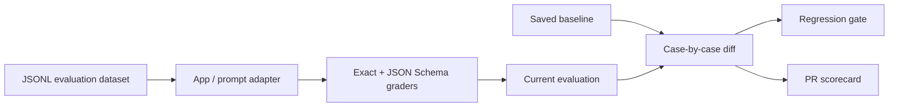

<p align="center"></p>
<h1 align="center">EvalDiff</h1>
<p align="center"><strong>Run your evals. See what changed.</strong><br>Dataset-driven regression evaluation for AI apps and prompts.</p>

<p align="center">
<a href="https://github.com/ArttuAn/evaldiff/actions/workflows/eval.yml"></a>


<a href="LICENSE"></a>
</p>


**An eval result is useful. A case-by-case diff is actionable.** EvalDiff runs a versioned JSONL dataset through your AI app, grades its outputs, and compares the results with a saved baseline. See which cases regressed, which improved, and whether a change should pass CI.

[Quick start](#-quick-start) · [Stability](#-catch-flaky-behavior) · [Dataset & graders](#-datasets--graders) · [Dashboard](#-inspect-your-evaluation) · [Adapters](#-evaluate-your-app) · [Baselines](#-baseline-comparisons) · [PR reports](#-evaluation-reports-in-pull-requests)

## ◎ An evaluation-first workflow

| Stage | What EvalDiff does |
|:--|:--|
| **Dataset** | Load JSONL cases with stable IDs, inputs, and explicit grading criteria |
| **Inference** | Run your JavaScript app or an OpenAI system prompt, case by case and optionally in parallel |
| **Grading** | Apply exact-match and JSON Schema graders; all graders must pass |
| **Results** | Save per-case outputs, grading reasons, errors, and durations |
| **Analysis** | Inspect tagged slices, per-grader pass rates, adapter errors, and p50/p95 latency |
| **Stability** | Repeat cases, retain every trial, and flag observed mixed-outcome behavior |
| **Dashboard** | Export a standalone, offline HTML scorecard with expandable case evidence |
| **Comparison** | Diff pass rates and identify newly failing, fixed, and existing failures |
| **CI gate** | Fail on any new regression—even when fixes elsewhere hide the rate drop |
| **PR report** | Update one bot comment with the evaluation scorecard and failing case IDs |



## 🚀 Quick start

Requires **Node.js 22+**. The deterministic example needs **no API key** and makes **no model calls**.

```bash
git clone https://github.com/ArttuAn/evaldiff.git
cd evaldiff
npm ci
npm test
npm run demo
```

```text
Passing: 10/10
Pass rate 100% → 100%, 0 new failures
```

Evaluate an intentionally regressed app:

```bash
node bin/evaldiff.js run \
  --cases examples/cases.jsonl \
  --adapter examples/regressed-app.mjs \
  --baseline examples/baseline.json \
  --out .evaldiff/current.json \
  --report .evaldiff/comparison.json \
  --markdown .evaldiff/report.md \
  --html .evaldiff/report.html \
  --summary .evaldiff/summary.json
```

```text
Passing: 7/10
  FAIL route-refund: "Output did not exactly match the expected value."
  FAIL extract-contact: "data must have required property 'email'"
  FAIL refusal: "Output did not exactly match the expected value."
Pass rate 100% → 70%, 3 new failures
```

**Exit `1` is expected:** the regression gate found three newly failing cases.


The graph reflects the included 10-case fixture, not a live model benchmark. Optional: `npm link` exposes the local `evaldiff` command. This project is distributed through GitHub and is **not published to npm**.

## 🔎 Triage regressions without rerunning everything

Inspect changed verdicts and failed-trial reasons from saved artifacts, with no inference:

```bash
node bin/evaldiff.js compare \
  --baseline baseline.json --current .evaldiff/current.json --details
```

After fixing your app, rerun only the cases that failed:

```bash
node bin/evaldiff.js run \
  --cases cases.jsonl --adapter my-app.mjs \
  --failed-from .evaldiff/current.json \
  --out .evaldiff/rerun.json --html .evaldiff/rerun.html
```

The original full-dataset artifact must match the supplied dataset (including IDs, inputs, graders, and tags). The source trial count is inherited automatically; conflicting `--repeat` values are rejected. This catches stale rerun requests before importing the adapter or spending money on inference.

**Reruns are separate subset evaluations**, not replacements for full-dataset CI. They have their own dataset fingerprint and cannot be combined with `--baseline` in the same invocation. If nothing failed, the command exits `2` without inference or writing a new artifact. Run the full suite again before merging. HTML case rows now label new regressions, fixes, existing failures, and unchanged passes.

## 🔁 Catch flaky behavior

A single passing run can hide inconsistent behavior. **`--repeat N`** runs every case N times, preserves every trial's output and grades, and reports cases with both passing and failing outcomes.

```bash
# A deterministic simulation: 30 trials, 27 passing, 3 flaky cases.
# Exit 1 is intentional because three cases fail the all-trials-pass policy.
npm run demo:stability
```

Open `.evaldiff/stability.html` to inspect each trial, or `.evaldiff/stability.json` for aggregate metrics.


For your own app, create a baseline and current run with the **same trial count**:

```bash
node bin/evaldiff.js run --cases cases.jsonl --adapter my-app.mjs \
  --repeat 5 --out baseline.json

# After changing your app or prompt:
node bin/evaldiff.js run --cases cases.jsonl --adapter my-app.mjs \
  --repeat 5 --baseline baseline.json --out .evaldiff/current.json \
  --summary .evaldiff/stability.json --html .evaldiff/stability.html
```

- **Case verdict:** every grader must pass in every trial. No retries that silently erase failures.
- **Flaky:** at least one passing and one failing trial were observed. Always-failing cases are failures, not flaky.
- **Evidence:** per-trial output, grading reasons, errors, and timings remain in the full run artifact and HTML explorer. Case-level evidence shows the first failed trial (or first passing trial if all pass).
- **Comparable baselines:** different repetition counts are rejected before inference. Legacy runs without a trial count are treated as single-trial runs.
- **Isolation:** inputs are cloned for each trial; returned JSON values are snapshotted. Adapter-global state and external systems are **not** reset; manage those in your adapter.
- **Timing and grading:** aggregates count individual trials; slice and global case verdicts use the all-trials-pass policy. Case time is the sum of trial times.
- **Bounds:** 1–100 trials per case, up to 100,000 total trials. Default is one. API calls and costs grow with the trial count.

This is observed stability, **not a confidence interval, an independence assumption, or a guarantee of future reliability**. The demo deliberately alternates working and broken fixtures; it is not live model data. Baseline regression gates remain case-level: an already failing flaky case is reported, but not a new regression.

## ◇ Datasets & graders

One JSON object per line. Blank lines are ignored. Each case needs a unique ID (1–100 letters, digits, dots, underscores, or hyphens), an input, and at least one grader.

```jsonl
{"id":"greeting","tags":["conversation","smoke"],"input":"Say hello","graders":[{"type":"exact","expected":"Hello!"}]}
{"id":"contact","input":"Extract Ada's email","graders":[{"type":"json-schema","schema":{"type":"object","required":["email"],"additionalProperties":false,"properties":{"email":{"type":"string","format":"email"}}}}]}
```

| Grader | Evaluation contract |
|:--|:--|
| `exact` | Strings match exactly, including whitespace and case. JSON values use deep structural equality; object key order does not matter. JSON encoded inside a string is still a string. |
| `json-schema` | Validate an output value, or parse a text output as JSON first. Uses Ajv strict mode, **draft-07**, and `ajv-formats`. No coercion, code-fence stripping, or default insertion. Invalid/unsupported schemas are configuration errors. |

Validate dataset syntax, IDs, tags, and schemas without importing an adapter or calling a model:

```bash
node bin/evaldiff.js validate --cases cases.jsonl
# Or: npm run validate (for the included dataset)
```

Optional **`tags`** group cases into evaluation slices (for example, `routing`, `extraction`, or `hard`). Use up to 20 unique tags per case, each 1–64 letters, digits, dots, underscores, or hyphens. A case may belong to several slices; slice counts overlap but the global count does not. Tags are fingerprinted dataset content, so changing them requires an intentional baseline refresh.

A case passes only when **all** its graders pass. Exceptions, invalid outputs, and timeouts become failed cases; remaining cases still run. Schema grading checks structure, not factual accuracy. For extraction tasks, add exact checks when you need to verify specific values as well as shape.

## 📊 Inspect your evaluation


`npm run demo` now generates `.evaldiff/report.html` and `.evaldiff/summary.json` alongside the full run, comparison JSON, and Markdown. Open the HTML file directly in a browser—no server, scripts, external fonts, or tracking required. A [generated example](docs/evaluation-report.html) is included; download it to view locally.

- **Slice performance:** find capability-specific regressions hidden by the overall average.
- **Grader breakdown:** separate exact-match failures from structural/schema failures. Counts are grader applications, not cases; adapter errors count as failed applications with an explicit “not evaluated” reason.
- **Latency:** nearest-rank p50/p95 over recorded per-trial durations, including failures. Missing legacy timings are excluded. These are observed wall times, not a controlled benchmark or a latency regression gate.
- **Case explorer:** expand any case to inspect its output, error, and grading evidence. Model output is HTML-escaped, never executed.
- **Portable metrics:** `--summary` exports aggregate metrics without raw outputs. `--html` works with or without a baseline, including on failing runs. Both also work with `compare`.

The example's timing values come from a deterministic local fixture and are usually near zero. Reports may contain sensitive outputs; review them before sharing.

## 🔌 Evaluate your app

### JavaScript adapter

```js
// my-app.mjs
export default async function evaluate(input, { id, trial, signal }) {
  const response = await fetch('https://your-app.example/respond', {
    method: 'POST', signal,
    headers: { 'Content-Type': 'application/json' },
    body: JSON.stringify({ input })
  });
  if (!response.ok) throw new Error(`App failed: ${response.status}`);
  return response.json(); // Or text; return the value your graders expect.
}
```

```bash
node bin/evaldiff.js run \
  --cases cases.jsonl --adapter my-app.mjs \
  --timeout 30000 --out .evaldiff/run.json
```

Adapters can wrap prompt chains, RAG apps, local models, or APIs. The context includes the case `id`, a one-based `trial` number, and an abort `signal`. Return a losslessly JSON-compatible value (no `undefined` fields, Dates, NaN, BigInt, or functions). They execute code: run only trusted adapters.

### OpenAI prompt adapter

```bash
export OPENAI_API_KEY='your-key-here'
node bin/evaldiff.js run \
  --cases examples/cases.jsonl --prompt examples/prompt.txt \
  --model gpt-4.1-mini --out .evaldiff/openai.json
```

Uses Chat Completions: the prompt becomes the system message, each input becomes a user message, and returned text is graded without normalization. `OPENAI_MODEL` sets the default model. Calls may incur charges and results may vary. The CLI does not load `.env` automatically; export variables or use `node --env-file=.env bin/evaldiff.js ...`.

Never expose provider keys to untrusted PR code. Live OpenAI calls were not used to validate this project.

### Run independent cases in parallel

Cases are independent, so slow API-backed evaluations can run several at once:

```bash
node bin/evaldiff.js run \
  --cases cases.jsonl --adapter my-app.mjs \
  --concurrency 4 --out .evaldiff/current.json
```

`--concurrency` accepts 1–32 (default 1). Cases are scheduled in parallel while **trials within a case stay sequential**, so `--repeat` ordering and evidence remain unchanged. Result order, verdicts, fingerprints, and comparisons are identical to a sequential run; only wall time changes.

The adapter still runs inside one process and shares its state. Raise concurrency only as far as your provider rate limits, costs, and logging tolerate; lower it if requests start timing out. Timeouts remain per trial, and a slow case does not delay the others.

## ↔ Baseline comparisons

Save a reviewed evaluation as a baseline:

```bash
node bin/evaldiff.js run \
  --cases cases.jsonl --adapter my-app.mjs --out baseline.json
```

Evaluate a later app version against it:

```bash
node bin/evaldiff.js run \
  --cases cases.jsonl --adapter my-app.mjs \
  --baseline baseline.json --out .evaldiff/current.json \
  --report .evaldiff/comparison.json --markdown .evaldiff/report.md
```

Compare existing evaluations without inference:

```bash
node bin/evaldiff.js compare \
  --baseline baseline.json --current .evaldiff/current.json \
  --report .evaldiff/comparison.json
```

- **New failure:** baseline pass → current fail. Any new failure fails the gate.
- **Fixed:** baseline fail → current pass.
- **Existing failure:** fails in both runs; visible but not a new regression.
- **Pass rate:** passing cases / total cases. The diff uses **percentage points**.
- **Dataset integrity:** fingerprinted inputs, graders, IDs, and metadata must match. Row order and object key order do not matter. A changed dataset requires an explicitly regenerated baseline. Compatibility is checked before inference when using `run --baseline`.
- **Baseline updates:** intentional, reviewed file changes—not automatic acceptance of a failing run. The CLI rejects artifact paths that overwrite inputs or collide with another output (including existing symlink aliases), and snapshots the baseline before inference.

| Exit | Meaning |
|:--:|:--|
| `0` | All cases pass without a baseline, or no newly failing cases with one |
| `1` | Failing cases without a baseline, or new regressions with one |
| `2` | Configuration, dataset, artifact, or file error |

Adapter/provider errors count as failed cases, so an outage can produce exit `1`.

## 🤖 Evaluation reports in pull requests


**[Live verification PR #1](https://github.com/ArttuAn/evaldiff/pull/1)** demonstrated a red **100% → 70%, 3 new failures** report, then updated the **same comment** to green after restoring the working adapter. Historical runs use the original project name. [Generated Markdown example →](docs/example-pr-comment.md)

The two-workflow design keeps evaluation and write permissions separate:

1. **[Evaluation regression checks](.github/workflows/eval.yml)** runs tests and the baseline evaluation with read-only permissions, saves artifacts even on regression, and writes an Actions summary.
2. **[Evaluation PR comment](.github/workflows/comment.yml)** is triggered by `workflow_run`, checks out **only default-branch code**, and downloads the triggering run's artifact. It never executes PR code or artifact content.
3. The **[reporter](scripts/comment-pr.mjs)** validates counts and conservative case IDs, renders its own Markdown, and upserts its bot comment. Closed PRs and stale results are skipped. Actions are pinned to verified commit SHAs.

To reuse: copy the source, package/lockfile, examples, scripts, and workflows; run `npm ci`; replace the demo command with your evaluation; merge the reporter into the default branch; and ensure repository/organization policy allows `pull-requests: write` for its token. Configure branch protection separately.

Fork evaluations run without secrets. Commenting requires GitHub to associate the workflow run with a PR; otherwise the reporter skips rather than guessing. A configuration failure before producing comparison data leaves no report artifact, so inspect the eval log if the reporter cannot download one.

## 🧪 Tests & layout

```bash
npm test        # 37 tests: graders, trials, concurrency, triage, isolation, analysis, exports, CLI
npm run demo    # Deterministic evaluation used in CI
```

CI tests Node.js **22 and 24** before running the evaluation gate. See [CHANGELOG.md](CHANGELOG.md) for release details.

```text
bin/evaldiff.js              CLI + optional OpenAI adapter
src/harness.js              Dataset loader, graders, runner, fingerprints, diffs
src/report.js               Validated evaluation summaries and Markdown
src/analysis.js             Slice/grader aggregation and latency percentiles
src/triage.js               Dataset-checked failure selection and case-level diffs
src/html.js                 Offline dashboard with safely escaped case evidence
scripts/comment-pr.mjs      Trusted PR report upsert
examples/                   Dataset, working/broken apps, prompt, baseline
test/                       Unit and CLI integration tests
docs/                       Original graphics and generated report
.github/workflows/          Evaluation gate + isolated reporter
```

## 🔒 Limits & security

- This is a regression evaluation tool, **not a sandbox or safety certification**. Adapters and schemas must be trusted.
- Timeouts cancel cooperative I/O; they cannot interrupt CPU-bound adapters or work that ignores abort signals.
- Artifacts/logs can contain outputs, grading reasons, and adapter exception text. Avoid sensitive datasets and secret-bearing errors; review artifact retention.
- No semantic judge, statistical confidence intervals, automatic retries, or factual verification. Exact matching is intentionally strict and may be unsuitable for free-form text.
- `--concurrency` parallelizes cases, not trials. Adapters may be called simultaneously, so protect shared mutable state and respect provider rate limits.
- A PR can change datasets, baselines, or workflows. Reports are not attestations; review those changes. Never run PR code in a write-enabled `pull_request_target` or reporting job.

## 🏷 Project signals

**Topics:** `llm-evaluation` · `evals` · `ai-testing` · `regression-testing` · `json-schema` · `github-actions` · `cli`

**Labels:** `area:graders` · `area:ci` · `area:cli` · `area:docs` · `type:bug` · `type:feature` · `good first issue`

Potential next steps—not shipped features: custom grader plugins, statistical confidence intervals, and trend history.

---
<p align="center"><br><strong>Evaluate behavior. Review the diff.</strong><br><sub>MIT licensed · Small, inspectable, evaluation-first.</sub></p>
